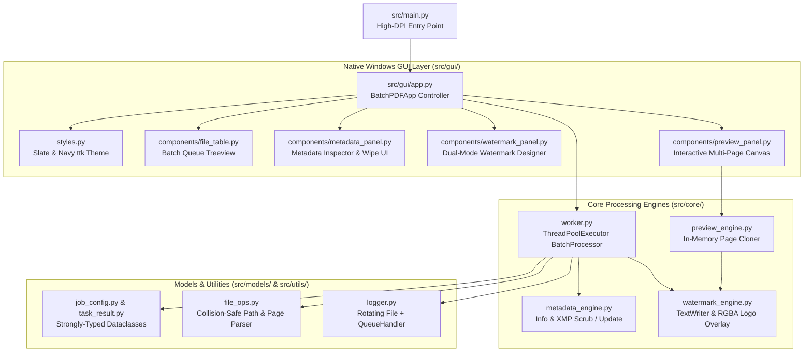

# Batch PDF Studio — Metadata & Watermarking Utility

An enterprise-grade, multi-module Windows desktop application built with Python 3.11+, **PyMuPDF (`fitz`)**, **Pillow**, and **High-DPI Tkinter (`ttk`)** for high-throughput batch PDF metadata sanitization, custom property injection, and dual-mode watermarking with live multi-page visual preview.

---

## Key Features

### 1. PDF Metadata Engine (Selective Injection & Complete Forensic Sanitization)
- **Selective Property Injection:** Update `Title`, `Author`, `Subject`, `Keywords`, `Creator`, and `Producer` across hundreds of PDFs while preserving untouched fields when inputs are left blank.
- **One-Click Metadata Inspector:** Load and inspect existing metadata from any queued PDF directly into the editor form.
- **Complete Metadata & XMP Scrub (`wipe_all=True`):** Scrubs all standard `/Info` dictionary keys (`title`, `author`, `subject`, `keywords`, `creator`, `producer`, `creationDate`, `modDate`), removes document-level XML/XMP metadata streams (`del_xml_metadata()`), and clears catalog/page `/Metadata` and `/PieceInfo` entries.

### 2. Dual-Mode Watermark Engine (Vector Text & Transparent PNG Logos)
- **Vector Text Stamps:** Configurable stamp string, font size, RGB color picker, opacity (`5%`–`100%`), and arbitrary rotation (`-90°` to `+90°`, plus quick `45°` and `0°` presets) rendered via `fitz.TextWriter` with morph rotation matrices.
- **Transparent Corporate Logo Overlay (PNG):** Loads RGBA PNG files via `Pillow`, modulates the alpha channel proportionally by opacity, scales relative to page geometry, and rotates cleanly (`BICUBIC`, `expand=True`).
- **3 Geometric Layouts:**
  - **Single Center:** Centered stamp on target pages.
  - **Diagonal Stamp:** Dead-center diagonal orientation across the page.
  - **Repeated Tiled Grid:** Multi-row, multi-column staggered lattice across the entire page bounding box to prevent cropping.
- **Flexible Page Range Targeting:** Apply watermarks to `"all"` pages or custom 1-based ranges (e.g., `"1-3, 5"`).

### 3. Non-Destructive Live Preview & Multi-Threaded Batch Processing
- **In-Memory Live Preview (`preview_engine.py`):** Clones only the active preview page into an in-memory `fitz.Document`, applies the current watermark configuration with a `250ms` debounce, and renders onto the High-DPI Tkinter canvas with `< Prev Page` / `Next Page >` navigation.
- **Multi-Threaded Worker Pool (`worker.py`):** Processes batches concurrently via `ThreadPoolExecutor` with graceful cancellation (`threading.Event`), garbage-collected PDF saving (`garbage=4, deflate=True`), and non-blocking `root.after()` UI progress and log streaming.
- **Zero-Overwrite Collision Protection (`file_ops.py`):** Supports appending custom suffixes in the source folder, saving to a dedicated output folder, or mirroring nested folder trees—auto-incrementing (`_1`, `_2`) whenever destination filenames collide.

---

## Modular Architecture



### Directory Structure

```text
batch-pdf-utility/
├── .gitignore
├── README.md
├── pyproject.toml
├── build_windows.spec
├── scripts/
│   └── build_exe.bat
├── src/
│   ├── __init__.py
│   ├── main.py
│   ├── core/
│   │   ├── __init__.py
│   │   ├── metadata_engine.py
│   │   ├── watermark_engine.py
│   │   ├── preview_engine.py
│   │   └── worker.py
│   ├── gui/
│   │   ├── __init__.py
│   │   ├── app.py
│   │   ├── styles.py
│   │   └── components/
│   │       ├── __init__.py
│   │       ├── file_table.py
│   │       ├── metadata_panel.py
│   │       ├── watermark_panel.py
│   │       └── preview_panel.py
│   ├── models/
│   │   ├── __init__.py
│   │   ├── job_config.py
│   │   └── task_result.py
│   └── utils/
│       ├── __init__.py
│       ├── file_ops.py
│       └── logger.py
└── tests/
    ├── __init__.py
    ├── conftest.py
    ├── test_metadata.py
    └── test_watermark.py
```

---

## Developer Setup & Running from Source

1. **Create and activate a virtual environment:**
   ```powershell
   python -m venv .venv
   .\.venv\Scripts\Activate.ps1
   ```

2. **Install the package in editable mode with development dependencies:**
   ```powershell
   pip install -e ".[dev]"
   ```

3. **Launch the desktop application:**
   ```powershell
   python -m src.main
   # Or via the registered entry-point script:
   batch-pdf-studio
   ```

4. **Run the automated unit test suite:**
   ```powershell
   pytest
   ```

---

## Building the Standalone Windows `.exe`

A complete PyInstaller specification (`build_windows.spec`) and automated batch build script (`scripts\build_exe.bat`) are included.

```powershell
# Run tests, compile windowed executable, and verify output:
.\scripts\build_exe.bat
```

Or run PyInstaller directly:
```powershell
pyinstaller --noconfirm --clean build_windows.spec
```

The standalone executable will be generated at:
```text
dist\BatchPDFStudio.exe
```

---

## Application Logs

Runtime logs are written to a rotating log file (`5 MB` max per file, 3 backups) at:
```text
~/.batch_pdf_utility/app.log
```
Live log events are simultaneously streamed into the collapsible **Live Activity Log Console** inside the desktop GUI.

